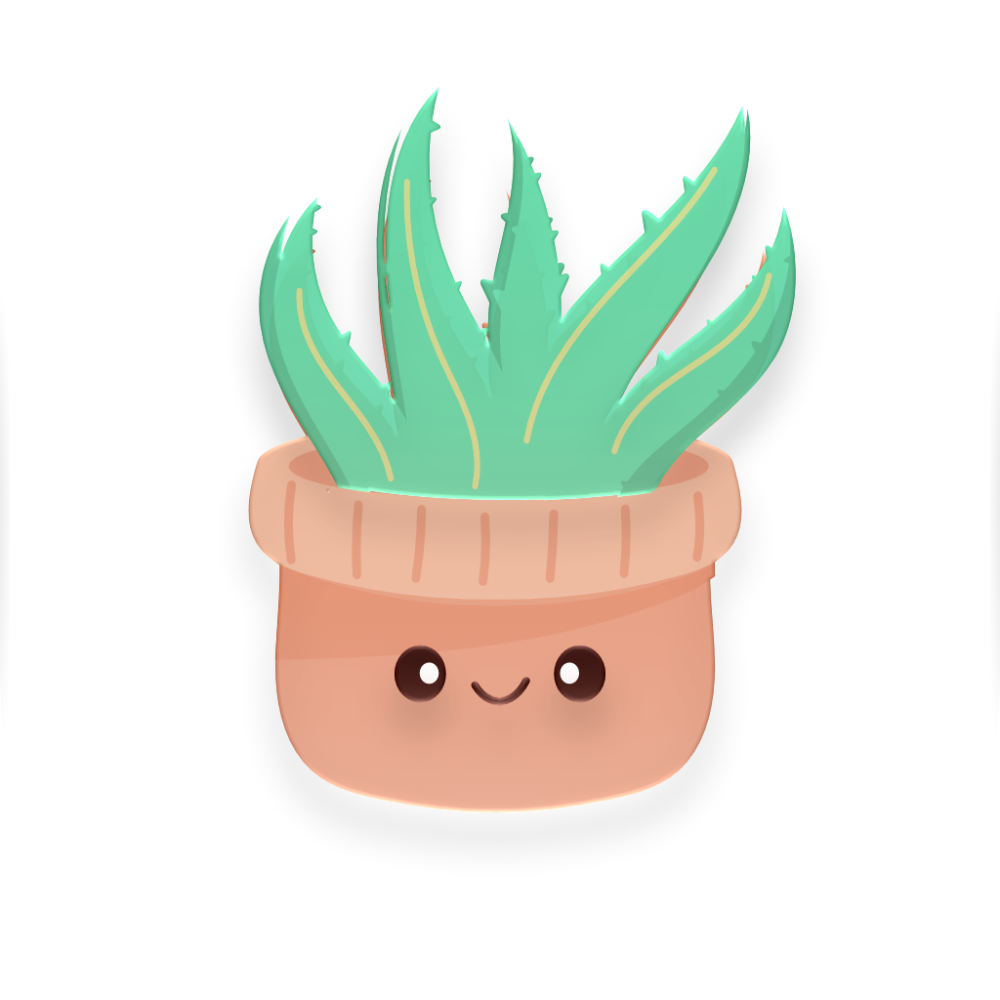

  

<h1 align="center">Planto</h1>

**Planto** is an iOS app that helps you keep your plants alive by tracking when each plant needs watering and reminding you on time.

## Features

- 🪴 Add your plants with their name, room, and watering schedule
- 💧 Track which plants need water today
- ✅ Mark plants as watered with a single tap
- 🔔 Get reminders when it's time to water

##Technologies Used

-Swift
SwiftUI
Liquid Glass
MVVM architecture
Xcode

## Screenshots

  
  
  
  

## Author

**Hanin Alsanei** – [@haninalsanei](https://github.com/haninalsanei)
